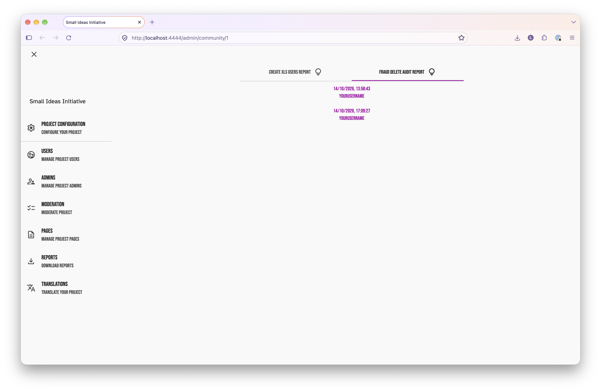
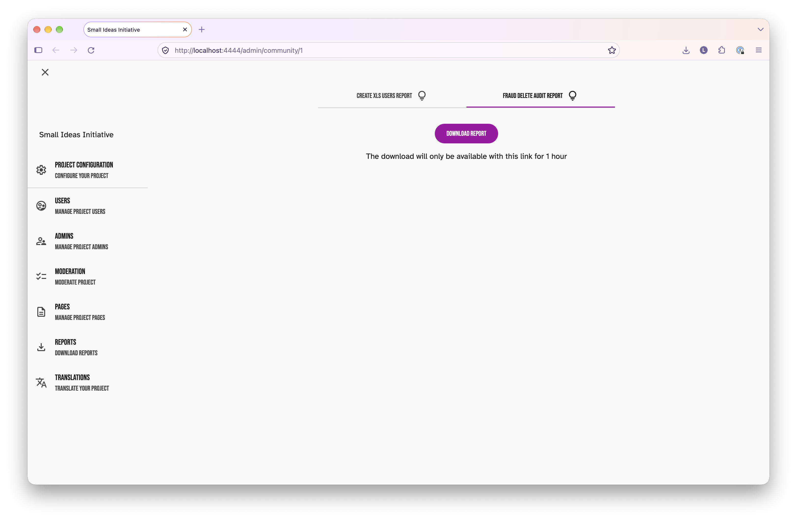

# Fraud management

When we allow users to vote, we're going to allow them to do it anonymously. So it's probably going to be important to be able to detect suspicious patterns of voting.

Your Priorities already advertises "fraud management" functionality so I thought I'd try to understand that better.

I got Claude to look into it and then I also played around with it myself locally in the admin UI. The admin UI is rather unintuitive (especially its repurposing of the term "group") and also the effect of the delete button is not very obvious. So I've gotten Claude to write up this report on the fraud management feature and the meanings of the stuff you see in the UI.

We can discuss internally whether we consider the fraud detection that YP offers to be sufficient or not.

This functionality is all after-the-fact; i.e. it doesn't do anything to prevent users from submitting votes. We need to understand whether this is likely to be a problem.

> [!important]
> The rest of this document is Claude-written and lightly human-edited; it shouldn't be put in front of the client as-is.

## What it is

An **after-the-fact** admin tool. It looks through votes and other content for clusters of suspicious activity (same IP, browser and so on), then lets an admin review them and delete them. It doesn't block anything as it happens. It's enabled per **community** and covers every group in that community.

## Switching it on

`/admin/community/1` → **Access** tab → tick **"Enable fraud detection"** → save.

> [!important]
> In local development, you need to make sure you're also [running the worker](../quick_start_guide.md#optional-terminal-4-worker), else the scans will never happen.

## Getting to the page

`http://localhost:4444/admin/community/1` → **Moderation** → **Fraud management** tab. The tab only appears once fraud detection is enabled.

- The **dropdown** chooses the content type: Endorsements (votes), Ratings, Point qualities (helpful/unhelpful votes on comments), Points (comments) or Posts. In the rest of this document, we only consider endorsements since we're considering fraud at the voting stage.
- The **tabs** choose the detection method.
- Opening the page, changing tab or changing the dropdown starts a scan.

## Detection methods (tabs)

> [!note]
> Neither the clustering nor the confidence score pay any attention to the user (i.e. the Your Priorities `User` entity) who created the vote.

> [!warning]
> One gotcha: switching tabs while a scan is running shows the wrong results. The tab changes, but the earlier scan's results appear under it. Wait for the progress bar to finish, or press **Reload** after switching.

| Tab | Clusters votes sharing | Useful? |
|---|---|---|
| IP & user agent & post | the same IP address, browser and post (shown if 2 or more votes) | To an extent; will detect unsophisticated attempts where a person simply uses the same browser to submit multiple votes from private tabs. But user agents are easily spoofable and users can use VPNs. It's also susceptible to false positives (e.g. offices and schools share IP addresses, as do ISP users on a CGNAT, and it's likely many people within them share user agents). |
| IP address | IP only, across posts (shown if an IP has more votes than there are posts) | Catches more (when users spoof user agents) but with more false positives (when users on a given IP don't share a user agent). But ultimately can be defeated similarly. |

**Confidence (`%`)** combines the cluster's size (bigger is more suspicious) with how close together its votes were (a burst is more suspicious). 

> [!note]
> There are also "IP & fingerprint & post", "IP & fingerprint", and "No fingerprint" tabs, but these are of no use to us since we disabled fingerprinting for this project in https://github.com/dxw/nesta-your-priorities/pull/13/. In particular, the first two tabs of this list will always just show an empty list of results, and the final tab will show all votes.

## Columns

> [!important]
> The `<G>` column and the "Group" field in the expanded row view are misleading; they have nothing to do with the Your Priorities `Group` entity and instead refer to the cluster number.

| Column | Meaning |
|---|---|
| ☐ | Select the row for bulk delete |
| **`<G>`** | **Cluster number**. Rows with the same number and colour are in the same cluster. The number is just a label (0, 1, 2…). |
| **`#`** | Number of votes in that cluster |
| IP Address, User Agent | The voter's IP and browser |
| **`%`** | Confidence score for the cluster |
| Date | When the vote was made |
| BrowserId, Fingerprint | Always blank now (see above) |
| UserId, Email | The voter. Anonymous users get a made-up `…_anonymous@citizens.is` email. |
| PostId | The post voted on |
| **Val** | The vote: `1` up, `-1` down |
| 🗑 (each row) | Delete **just this vote** |

"(23 items)" in the heading is the total number of rows. Clicking a row expands its details: the full user agent, post name and so on.

## Actions

- **Reload** (or the ↻ icon) reruns the scan for the current tab.
- **"Delete all but one in group *N*"** (and the 🗑 in the column header): ***N* is the number of selected rows, not a cluster number; the label for this button is confusing.** It looks **only at the selected rows**, clusters them using the current tab's rule, and deletes all but one in each cluster. It keeps the earliest vote from a logged-in (non-anonymous) user if there is one, otherwise just one of them.
  - To reduce a whole cluster to a single vote, select **all** its rows.
  - Selecting **some** rows of a cluster deletes all but one *of those*. The unselected rows remain, so the cluster still shows afterwards.
  - Selecting a **single** row of a cluster deletes nothing. Use that row's own 🗑 instead.
- Deleted items are marked as deleted (`deleted` is set to `true`) rather than removed from the database, so they stop counting but can still be reported on, and could in principle be restored. Vote totals are recalculated, the deletion is recorded in an audit log (see [Audit report](#audit-report)), and the scan runs again.

## Audit report

The fraud audit report is a spreadsheet of the items removed in one deletion, with their emails, IPs and user agents. To get it:

1. `http://localhost:4444/admin/community/1` → **Reports**.
2. Choose the **Fraud Delete Audit Report** tab and press **Create Report**. This lists past deletions (date and who did it).

   

3. Pick a deletion. The worker generates the spreadsheet, and the page then shows a **Download report** button.

   

   

Items that are only flagged (not deleted) aren't saved anywhere, and the fraud management grid has no export; take a screenshot if you need a record.

## Automatic scanning

There's also a script, `FraudScannerNotifier.cjs`, that scans every community with fraud detection on and emails the community admins whenever the number of items flagged with over 75% confidence has changed since its last run.

As things stand it isn't usable: nothing runs it automatically, there's no documentation on how to set it up, and the "No fingerprint" method flags every vote, so it would email whenever anyone voted.
