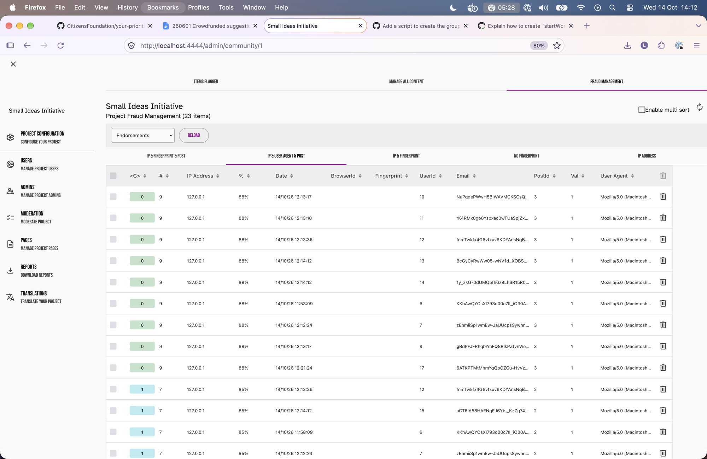
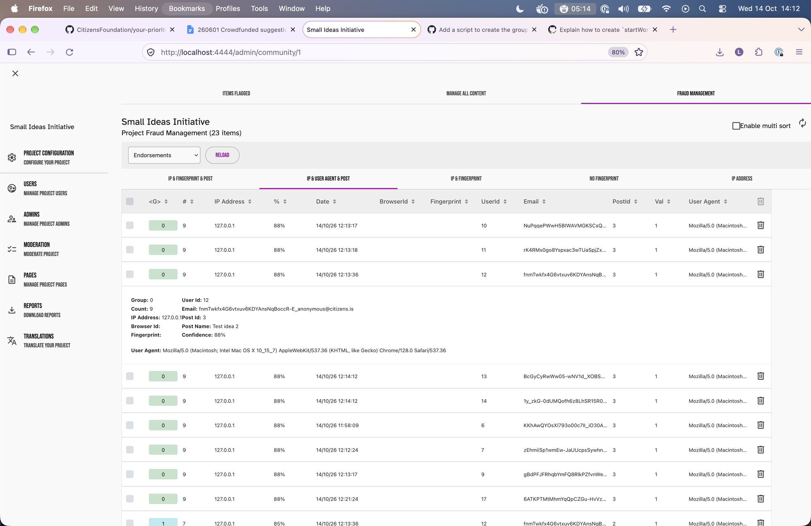
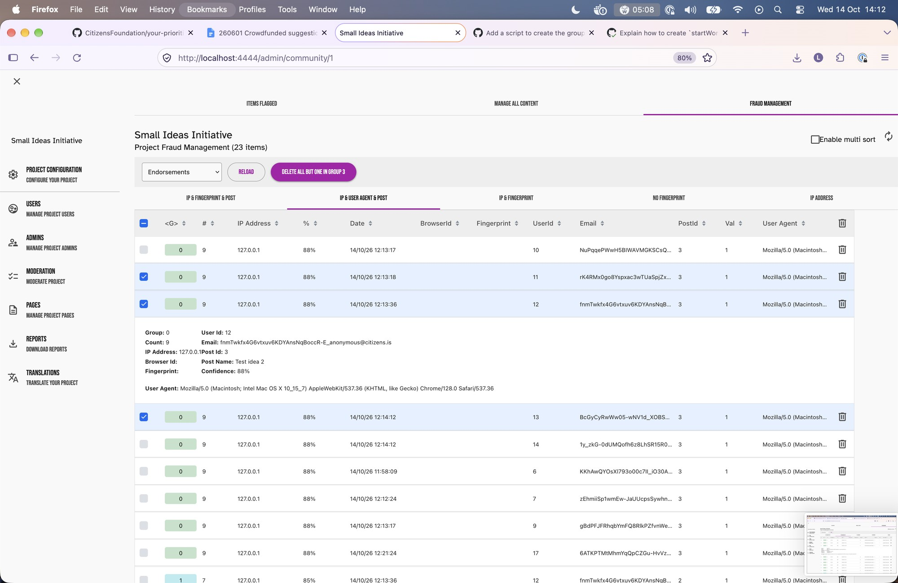

# Fraud management

## What it is

An **after-the-fact** admin tool. It looks through votes and other content for clusters of suspicious activity (same IP, browser and so on), then lets an admin review them and delete them. It doesn't block anything as it happens. It's enabled per **community** and covers every group in that community.

## Setup (local development)

1. **Run the worker.** Scans and deletions run as background jobs.
   - `cd server_api && cp startWorkerWithEnv.sh-dist startWorkerWithEnv.sh`
   - Set the `YP_DEV_DATABASE_*` values in it (same as in `startWatchWithEnv.sh`), then run `./startWorkerWithEnv.sh`.
   - Without the worker, the progress bar sticks at 0. The worker doesn't restart when code changes.
2. **Enable it for the community:** `/admin/community/1` → **Access** tab → tick **"Enable fraud detection"** → save.
3. **Optional, for downloading the fraud audit report only:** minio (local S3). See "Audit report" below.

## Getting to the page

`http://localhost:4444/admin/community/1` → **Moderation** → **Fraud management** tab. The tab only appears once fraud detection is enabled.

- The **dropdown** chooses the content type: Endorsements (votes), Ratings, Point qualities (helpful/unhelpful votes on comments), Points (comments) or Posts.
- The **tabs** choose the detection method.
- Opening the page, changing tab or changing the dropdown starts a scan.



## Detection methods (tabs)

| Tab | Clusters votes sharing | Useful now? |
|---|---|---|
| **IP & USER AGENT & POST** | the same IP address, browser and post (shown if 2 or more votes) | **Yes**: the same device and network voting repeatedly on one post |
| IP & FINGERPRINT & POST | IP, browser fingerprint and post | **No.** Browser fingerprints are no longer collected, so this finds nothing. |
| IP & FINGERPRINT | IP and fingerprint, across posts | **No**, same reason |
| NO FINGERPRINT | every vote without a fingerprint | **No.** It flags *every* vote at 100%. Bulk delete is disabled on this tab. |
| IP ADDRESS | IP only, across posts (shown if an IP has more votes than there are posts) | Noisy: offices, schools and mobile networks share IPs |

**Confidence (`%`)** combines the cluster's size (bigger is more suspicious) with how close together its votes were (a burst is more suspicious). It ignores *who* the user is, so different people on the same network and browser cluster together. That's why an admin reviews before deleting.

## Columns

| Column | Meaning |
|---|---|
| ☐ | Select the row for bulk delete |
| **`<G>`** | **Cluster number**, not a group in the app's sense. Rows with the same number and colour are in the same cluster. The number is just a label (0, 1, 2…). |
| **`#`** | Number of votes in that cluster |
| IP Address, User Agent | The voter's IP and browser |
| **`%`** | Confidence score for the cluster |
| Date | When the vote was made |
| BrowserId, Fingerprint | Always blank now (see above) |
| UserId, Email | The voter. Anonymous users get a made-up `…_anonymous@citizens.is` email. |
| PostId | The post voted on |
| **Val** | The vote: `1` up, `-1` down |
| 🗑 (each row) | Delete **just this vote** |

"(23 items)" in the heading is the total number of rows. Clicking a row expands its details: the full user agent, post name and so on.



## Actions

- **Reload** (or the ↻ icon) reruns the scan for the current tab.
- **"Delete all but one in group *N*"** (and the 🗑 in the column header): ***N* is the number of selected rows, not a cluster number.** It looks **only at the selected rows**, clusters them using the current tab's rule, and deletes all but one in each cluster. It keeps the earliest vote from a logged-in (non-anonymous) user if there is one, otherwise just one of them.
  - To clean up a whole cluster, select **all** its rows.
  - Selecting **some** rows of a cluster deletes all but one *of those*. The unselected rows remain, so the cluster still shows afterwards.
  - Selecting a **single** row of a cluster deletes nothing. Use that row's own 🗑 instead.
- Deleted items are hidden rather than erased. Vote totals are recalculated, the deletion is recorded in an audit log, and the scan runs again.



## Gotchas

- **Switching tabs while a scan is running shows the wrong results:** the tab changes, but the earlier scan's results appear under it. Wait for the progress bar to finish, or press **Reload** after switching.
- **"Group"** in `<G>`, the button label and the row details means a cluster, not a group in the app's sense.
- **The audit report only covers deletions,** not everything that was flagged. Flagged items exist only in the grid: there's no export, and they aren't saved. To keep a record, take a screenshot.

## Audit report

- **The list** of past deletions (date and who did it) shows on the community **Reports** page.
- **The fraud audit report** is a spreadsheet of the items removed in one deletion, with their emails, IPs and user agents. Downloading it needs local S3 (minio). Not tried yet, but the steps should be:
  1. In `development/docker/.env`, replace the placeholder `MINIO_ROOT_USER=<user>` and `MINIO_ROOT_PASSWORD=<password>` with real values, e.g. `minioadmin` and `minioadmin123`. The placeholders stop the buckets being created.
  2. `cd development/docker && docker compose up minio mc -d`
  3. Add to `server_api/startWorkerWithEnv.sh`:
     ```
     export S3_ENDPOINT=http://localhost:9012
     export S3_REPORTS_BUCKET=minio.yrpri.reports
     export AWS_ACCESS_KEY_ID=minioadmin
     export AWS_SECRET_ACCESS_KEY=minioadmin123
     export S3_FORCE_PATH_STYLE=true
     export S3_REGION=us-east-1
     ```
  4. Restart the worker.

## Automatic scanning

There's also a script that scans every community with fraud detection on and emails the community admins when the number of high-confidence items changes. Nothing runs it automatically; it would need to be scheduled.
